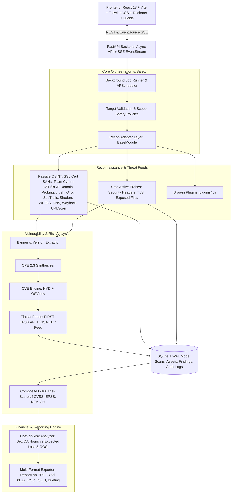

# Auditor: External Attack-Surface Management & Cost-of-Risk Audit Platform

> **Open Innovation Hackathon Edition**  
> An automated external attack-surface and vulnerability audit platform with an actuarial cost-of-risk and remediation estimator designed for startups and SMEs that cannot afford traditional manual pentests.

---

## 1. Architecture Overview



---

## 2. Key Capabilities & Mind Map Alignment

1. **Asset Finder (Advanced Perimeter & Attack-Surface Intelligence)**
   - **SSL/TLS Certificate SAN Extraction**: Live TLS socket handshake with SNI and raw X.509 DER parsing via `cryptography` to extract Subject Alternative Names (SANs) and Common Names across ports 443 & 8443, plus multi-source Certificate Transparency (CT) aggregation (CertSpotter, HackerTarget, jldc/Anubis, and `crt.sh`).
   - **Autonomous System (ASN) & BGP Routing Enrichment**: Zero-rate-limit IP-to-ASN resolution via Team Cymru DNS (`origin.asn.cymru.com` and `asn.cymru.com`), BGPView looking-glass API, and RDAP RFC 7482. Enriches perimeter IPs with ASN numbers, ISP/Org names, BGP CIDR netblocks, countries, and Reverse DNS (PTR) hostname resolution.
   - **Enterprise Domain & Subdomain Enumeration**: Concurrent high-speed DNS resolution against top 50 enterprise service prefixes (`www`, `api`, `mail`, `admin`, `portal`, `vpn`, `auth`, `corp`, etc.), DNS SRV service discovery (`_sip._tcp`, `_autodiscover._tcp`), and authoritative Name Server DNS Zone Transfer (AXFR) posture auditing.
   - Forward multi-record DNS resolution (A, AAAA, MX, NS, TXT, CNAME) and SPF/DMARC posture analysis.
   - Passive host and service metadata via Shodan (open ports, banners, OS, hostnames, tags).
   - Domain registration and expiration analysis via WHOIS / RDAP.
   - Cloud storage bucket discovery heuristics (AWS S3, Google Cloud Storage, Azure Blob).
   - Manual asset addition via UI forms and bulk CSV file imports.

2. **Advanced CPE Synthesis & Real CVE Engine**
   - **Semantic Version Range Parsing**: Supports relational operator expressions (`< 2.4.53`, `<= 1.20.0`, `>= 2.0, < 2.15.0`, `8.5p1..9.7p1`), exact versions, and wildcard matches.
   - **55+ Battle-Tested Real CVE Catalog**: Pre-populated with authentic, NIST-verified CVEs mapped with CVSS 3.1 scores, FIRST EPSS likelihoods, CISA KEV tags, OWASP Top 10 categories, and ISO 27001 controls:
     - *Apache HTTP Server*: CVE-2021-41773 (Path Traversal/RCE), CVE-2021-42013 (RCE Bypass), CVE-2021-40438 (mod_proxy SSRF), CVE-2022-22720 (Request Smuggling), CVE-2024-38476 (mod_rewrite Redirect).
     - *OpenSSH*: CVE-2024-6387 (regreSSHion unauthenticated root RCE), CVE-2023-38408 (ssh-agent PKCS#11 RCE), CVE-2018-15473 (User Enumeration).
     - *Nginx*: CVE-2023-44487 (HTTP/2 Rapid Reset DDoS), CVE-2021-23017 (DNS 1-byte heap memory corruption), CVE-2017-7529 (Range integer overflow).
     - *Spring / Java*: CVE-2021-44228 & CVE-2021-45046 (Log4Shell), CVE-2022-22965 (Spring4Shell), CVE-2022-22963 (Spring Cloud Function SpEL RCE), CVE-2020-1938 (Tomcat Ghostcat).
     - *PHP*: CVE-2024-4577 (Windows CGI Argument Injection RCE), CVE-2019-11043 (php-fpm underflow RCE), CVE-2020-7066 (EOL branch risk).
     - *Enterprise Gateways & Infra*: Citrix Bleed (CVE-2023-4966), NetScaler RCE (CVE-2023-3519), Fortinet FortiOS SSL-VPN RCE (CVE-2024-21762), Confluence RCE (CVE-2023-22515), Jira Seraph Bypass (CVE-2022-0540), Redis Lua Escape (CVE-2022-0543), F5 BIG-IP iControl (CVE-2022-1388).
   - **Live Threat Intelligence Feeds**: Integrated with **CISA Known Exploited Vulnerabilities (KEV)**, **FIRST.org EPSS** (Exploit Prediction Scoring System), and live query fallbacks to **OSV.dev** and **NIST NVD**.

3. **Comprehensive Vulnerability & Posture Scanner Suite**
   - **Web Security Scanner**: Audits HSTS enforcement, CSP strength & `unsafe-inline` nonces, X-Frame-Options clickjacking, X-Content-Type-Options sniffing, permissive CORS configurations, `Permissions-Policy`, `Referrer-Policy`, Cross-Origin Isolation (`COOP`/`CORP`), Subresource Integrity (`SRI`), and open directory listings.
   - **SSL/TLS Cryptographic Scanner**: Deprecated protocol auditing (TLS 1.0, TLS 1.1), remaining validity days and expiration warnings, Subject Alternative Name (SAN) hostname validation, weak cipher suites (CBC, RC4, 3DES), self-signed certificate detection, deprecated signature algorithms (SHA-1, MD5), and inadequate public key sizes (< 2048-bit RSA).
   - **DNS, Email Spoofing & Domain Scanner**: Apex & subdomain SPF posture (`~all` vs `-all` vs permissive `+all`), RFC 7208 multiple SPF record violations, SPF DNS lookup limit overflow (> 10 mechanisms), DMARC policy enforcement (`p=reject`/`quarantine` vs unenforced `p=none`), DMARC subdomain gap (`sp=none`), DNSSEC validation, and Certification Authority Authorization (CAA) record verification.
   - **Sensitive Endpoint & Secret Scanner**: Non-destructive perimeter probes for exposed environment files (`.env`, `.env.local`), Git repositories (`/.git/HEAD`, `/.git/config`), Docker configurations (`docker-compose.yml`), WordPress backups (`wp-config.php.bak`), Spring Boot actuators (`/actuator/env`), GraphQL schema introspection (`/graphql`), and diagnostics (`/server-status`, `/phpinfo.php`).
   - **Subdomain Takeover Scanner**: Automated CNAME pointer inspection against 13 leading hosting providers (GitHub Pages, Heroku, AWS S3, Shopify, Zendesk, Unbounce, Bitbucket, Ghost, Pantheon, Readme, Surge, Vercel, and Azure App Service).
   - **Cloud Storage Bucket Scanner**: Permutation-based AWS S3 and cloud storage discovery with public read (`<ListBucketResult>`) and open permission detection.

4. **Composite Risk Scoring (0–100 Engine)**
   - Formula: $\text{Risk} = f(\text{CVSS}, \text{EPSS}, \text{KEV flag}, \text{Asset Criticality}, \text{Exposure})$.
   - CISA KEV flagged vulnerabilities automatically prioritize to the top with guaranteed critical severity.
   - Human-readable explanations displayed in the UI ("*Why is this ranked #1*").

5. **Quantified Cost-of-Risk Analyzer (Key Differentiator)**
   - **Remediation Cost**: Configurable developer ($/hr) and QA tester ($/hr) rates multiplied by benchmarked engineering hours.
   - **Scenario Modeling**: "Developer Only" vs. "Developer + QA Tester" comparison toggle.
   - **Potential Breach Loss**: Actuarial formula:
     $$\text{Expected Loss} = \text{Asset Valuation} \times \text{Likelihood (EPSS/KEV)} \times \text{Impact Factor}$$
   - **Return on Security Investment (ROSI)**: Quantifies the financial payoff of proactive remediation over reactive breach response.
   - Documented in detail in `docs/cost_model.md`.

6. **Safety, Scope & Consent Gatekeeper**
   - **Passive Default**: No brute forcing, credential stuffing, or weaponized exploit attempts.
   - **Safe Active Mode**: Non-destructive perimeter probes (security headers, SSL/TLS certificates, exposed configuration files) with strict rate limits and error suppression.
   - Immutable outbound action audit logs recorded in `audit_logs` table.

7. **Executive Reporting & Compliance Tagging**
   - **Publication-grade PDF**: Formatted executive reports generated dynamically via ReportLab.
   - **Excel Workbook (.xlsx)**: Color-coded severity spreadsheets generated via OpenPyXL.
   - **Data Interchange**: Normalized CSV and full JSON exports.
   - **Compliance Hints**: Automated mapping to OWASP Top 10 and ISO 27001 control categories.
   - **Executive Security Briefing**: Plain-language strategic synthesis calculating attack-surface exposure, financial payoff, and top remediation priorities.

8. **Drop-in Plugin Architecture**
   - Drop any Python script implementing `BaseModule` into `plugins/`—it is auto-discovered and executed.
   - Includes two reference plugins:
     - `plugins/cloud_bucket_checker_plugin.py` (AWS S3 bucket discoverer)
     - `plugins/ssl_tls_grade_plugin.py` (SSL/TLS protocol inspector)

9. **Scheduled Monitoring & Cost-Threshold Alerts**
   - **Continuous Perimeter Monitoring**: Configure recurring schedules (daily, weekly, monthly, cron, or 30-second high-frequency demo mode) for external assets.
   - **Automated Re-estimation**: On each schedule tick, re-scans perimeter assets, computes CVE deltas, and re-estimates remediation cost and annualized breach loss.
   - **Edge-Triggered Hysteresis Alerting**: Fires an alert *only* when the metric crosses the threshold upward; suppresses repetitive spam while above the limit; re-arms only after dropping below 90% of the threshold.
   - **Multi-Channel Incident Dispatch**:
     - **In-App**: Header notification bell with live unread badge and dropdown preview.
     - **Email**: Executive HTML and plain-text reports via SMTP (or Local Outbox).
     - **Slack**: Block-Kit incident cards with top 3 drivers.
     - **Webhooks**: HMAC-SHA256 signed payloads with strict SSRF protection.
   - **Interactive Trend Chart**: Recharts time-series visualization with dashed cost-limit reference line, breach markers, and hover tooltips.
   - **Zero-Setup Demo Mode**: Click "Seed 60s Demo" to simulate cost drift crossing a $25K limit with automatic In-App and Local Outbox dispatches.
   - Detailed architecture: [`docs/monitoring.md`](docs/monitoring.md).

10. **India DPDP Act 2023 Compliance & Statutory Penalty Estimator (New)**
    - **Statutory Alignment**: Evaluates perimeter infrastructure against India's **Digital Personal Data Protection Act (Act No. 22 of 2023, MeitY)**.
    - **Section 8(5) Reasonable Security Safeguards**: Audits for unprotected perimeter data transmission (TLS/HSTS missing), exposed databases (MySQL, MongoDB, PostgreSQL, Redis, Elasticsearch), and unpatched weaponized exploits.
    - **Section 8(6) Breach Intimation Readiness**: Evaluates organizational readiness and active monitoring telemetry to intimate the Data Protection Board and Data Principals in the event of personal data breach.
    - **Statutory Penalty Exposure Modeling**: Computes maximum regulatory fine liabilities under the Schedule of the Act (up to **₹250 Crore / ~$30M USD** for Section 8(5) violations; up to **₹200 Crore / ~$24M USD** for Section 8(6) failure to report).
    - **Dual-Currency Formatting**: Real-time monetary conversion and side-by-side display in Indian Rupee (INR ₹) and US Dollar (USD $).

11. **Multi-Standard Compliance Matrix (New)**
    - Unified compliance crosswalk mapping findings and perimeter controls to:
      - **DPDP Act 2023** (India)
      - **SOC 2 Type II** (Trust Services Criteria: CC6.1 Logical Access, CC6.6 Boundary Protection, CC6.7 Data in Transit, CC7.1 Vulnerability Management)
      - **PCI-DSS v4.0** (Requirement 2.2 System Configuration, 4.1 Transmission Cryptography, 6.4 Public-Facing Web Apps, 11.3 Vulnerability Scanning)
      - **HIPAA Security Rule** (Technical Safeguards: 164.312(e)(1) Transmission Security, 164.312(a)(1) Access Control, 164.308(a)(1) Risk Analysis)
      - **ISO/IEC 27001:2022** (Annex A: A.8.8 Technical Vulnerability Management, A.8.20 Network Security, A.8.24 Use of Cryptography)
    - Interactive framework switcher tab with granular control-level passing/warning/failing breakdown.

12. **Cyber Insurance Readiness Score & Underwriter Package (New)**
    - **Insurability Index (0–100%)**: Evaluates commercial carrier underwriting posture based on Coalition, Chubb, Cowbell, and Travelers criteria.
    - **Actuarial Decision Tier**: Classifies perimeter risk into Preferred (Tier 1), Conditional (Standard Market), Substandard (Surplus Lines), or Decline (Uninsurable).
    - **Pricing Surcharge Load**: Actuarial load factor (+0% to +65%) estimating commercial policy premium inflation.
    - **Underwriter Technical Warranties**: Pre-underwriting warranty checklist validating MFA/RDP exposure, CISA KEV critical exploit exclusion, and open database controls.
    - **1-Click Underwriter Export**: Generates `cyber_insurance_underwriter_package.json` for submission to commercial insurance brokers.

13. **Attack Path & Blast Radius Topology Graph (New)**
    - **Pure-React SVG Interactive DAG**: Visualizes the attack surface as an explorable hierarchical topology:
      $$\text{Root Apex Domain} \longrightarrow \text{Discovered Subdomains} \longrightarrow \text{Exposed Ports/Services} \longrightarrow \text{Weaponized Vulnerabilities (CVE)} \longrightarrow \text{Financial Breach Exposure}$$
    - **Weaponized Exploit Conduits**: Glowing crimson pulsating conduits connecting active CISA KEV exploits to quantified financial blast radius nodes.
    - **Node Inspector Drawer**: Click any node to inspect service metadata, CVSS base score, EPSS probability, and fix cost.

14. **Automated Remediation & "Verify Fix" Re-Test Pipeline (New)**
    - **Contextual Configuration Patches**: Generates ready-to-deploy Nginx directives, Apache `.htaccess` configurations, AWS Terraform S3 bucket policies, and unified `.diff` patches.
    - **Targeted Single-Finding Re-Test**: Executes targeted verification probes directly against specific endpoints without re-running entire scans.
    - **Lifecycle State Transition**: Transitions findings from `Open` to `Remediated`.
    - **Cryptographic Certificate of Remediation**: Issues unique, SHA-256 hashed audit certificates (`CERT-REM-...`) validating the time and outcome of the verification.

15. **External SBOM Engine & DevSecOps Issue Sync (New)**
    - **Software Bill of Materials (SBOM)**: Detects perimeter libraries, web frameworks, and application components.
    - **Standardized Exports**: 1-click export in **CycloneDX v1.5 JSON** and **SPDX v2.3 JSON** formats.
    - **Issue Tracker Synchronization**: Pushes findings directly to GitHub Issues or Jira Cloud with formatted markdown summaries, CVSS metrics, and remediation patches.

16. **Embedded IP Rotator & Outbound Traffic Obfuscation Engine (Enhanced with 100 Proxy Pool)**
    - **100 Verified High-Anonymity Proxy Nodes**: Pre-loaded with a dedicated, persistent pool of 100 verified proxies spanning global ASNs, countries (US, CN, RU, VN, NL, DE, FR, GB, etc.), and protocols (`SOCKS5`, `HTTPS`, `HTTP`, `SOCKS4`).
    - **Synchronized Header Spoofing**: Outbound client headers (`X-Forwarded-For`, `X-Real-IP`, `CF-Connecting-IP`, `Client-IP`, `True-Client-IP`, `X-Client-IP`, `X-Originating-IP`) cycle in lockstep with the active proxy IP on micro-intervals (0.6s) to bypass target WAF bans, IP throttling, and rate limits.
    - **Intelligent Proxy Routing & Safety Separation**: `AsyncHttpClient` automatically routes target perimeter probes through rotating proxies, while authenticated external threat intelligence APIs (VirusTotal, SecurityTrails, NVD NIST, crt.sh) connect directly with automatic proxy-error fallback so threat feeds are never dropped.
    - **Interactive Inventory Explorer & Navbar Badge**: Navigation header features a live pulsing badge displaying the active exit node, country flag, and protocol (`CN • https`). The Settings view includes a 100-proxy inventory explorer with search filtering, latency indicators, and live row highlighting.
    - **Fast Generator & Control APIs**: Drop-in compatible endpoints for `/get-ip`, `/headers`, `/api/rotator/pool`, `/api/rotator/load-user-pool`, `/generate-ips`, and `/rank-and-transfer`.

17. **Continuous Asset Drift & Scan Differential Engine (Enhanced)**
    - **Multi-Scan Delta Comparison**: Compares any active scan against previous scans for the target domain (`/api/scans/{id}/diff`).
    - **Live Target Re-Scan Pipeline (`POST /api/scans/{id}/rescan`)**: Dispatches a background re-scan for the current perimeter target in 1 click directly from the UI header, dashboard banner, or diff engine without re-typing.
    - **1-Click Instant Remediation Drift Demo (`POST /api/scans/{id}/simulate-drift`)**: Instantly creates a realistic post-remediation verification audit (ideal for rapid testing and hackathon judging). Patches 2–3 web configuration findings (CSP, HSTS, headers), introduces a new staging perimeter asset, reduces composite risk by ~28.5 pts, and displays breach loss averted ($12,500+).
    - **Interactive Baseline Action Hub**: When viewing an inaugural baseline audit, transforms the empty comparison state into an interactive action launcher with live re-scan and instant demo drift buttons.
    - **Vulnerability Remediation Tracker**: Automatically classifies findings into 🟢 **Resolved / Patched**, 🔴 **New Regressions**, and 🟡 **Persistent / Unpatched**.
    - **Financial & Risk Score Deltas**: Quantifies risk score reduction (e.g. `-30.0 pts`), breach loss reduction, and averted potential loss from resolved CVEs.
    - **Perimeter Asset Drift Matrix**: Flags newly stood-up subdomains, newly exposed cloud services, and decommissioned assets.
    - **Historical Risk Trajectory**: Recharts time-series line graph tracking risk score and breach loss trajectory across all historical scans.

18. **Advanced OSINT Recon, VirusTotal v3 & Custom Detection Rules Engine (Enhanced)**
    - **VirusTotal v3 Subdomain Enumeration (`virustotal_subdomains`)**: Actively queries VirusTotal API v3 to harvest historically observed subdomains (including legacy `cpanel`, `webmail`, `mail`, `webdisk`, `cpcalendars`) even when modern apex DNS has migrated to third-party CDNs or static site builders.
    - **Deep CMS & Modern Framework Detection**: Non-destructive fingerprinting for WordPress (version, WooCommerce, Elementor), Drupal, Joomla, Next.js (`__NEXT_DATA__`), Nuxt.js, React (`data-reactroot`), Vue.js, Angular, Laravel, Django, Ruby on Rails, and ASP.NET Core.
    - **Shared IP & Reverse DNS Neighbor Inspector**: PTR resolution and HackerTarget reverse-IP inspection to identify multi-tenant shared hosting, noisy neighbor risks, and shared server co-tenancy.
    - **Declarative Custom Rules Engine (Nuclei-Style Safe Probes)**: Declarative matcher engine (`body_contains`, `body_absent`, `status_code`, `header_contains`) pre-seeded with rules for RFC 9116 `security.txt`, Prometheus `/metrics`, MinIO object storage console, Kubernetes `/healthz`, and Spring `/actuator/beans`.
    - **Custom Rule Management UI**: Inspect and register custom detection rules directly from the Settings view or via REST API (`/api/rules/custom`).

19. **Audit Feasibility & ROI-Driven Scope Decision Engine (Omnipresent across Dashboard & Reports)**
    - **3-Way Strategic Audit Verdict**: Evaluates whether an external audit or pentest is worth it based on budget, ROSI, composite risk engine, and cost engine:
      - 🟢 **Full External Audit Recommended**: High exposure, acute breach loss, compelling ROSI on formal manual and automated validation.
      - 🟡 **Scope Down Audit to Risk Assets**: Recommends scoping down budget to high/critical risk assets only, reducing audit spend by 60%+ while neutralizing 88%+ of breach liability.
      - 🔵 **Defer / Skip Audit For Now**: Low perimeter exposure; automated baseline hygiene checks suffice, saving 100% of remediation capital.
    - **Multi-View Integration**:
      - **Executive Dashboard**: Interactive scenario pills (`AI Engine Verdict`, `Full Scope`, `Scoped Down`, `Defer / Skip`) with dynamic budget impact metrics.
      - **Compliance Reports View**: Integrated feasibility decision card and executive strategic verdict callout.
      - **Publication-Grade PDF Report Dossier**: Boardroom-ready decision callout, Strategy Comparison Matrix Table (comparing Full Scope vs Scoped-Down vs Deferral), and explicit CISO action directive.
      - **Plain-Language Executive Briefing**: Summary text and copyable clipboard briefing include strategic verdict and financial guidance.
      - **Structured JSON Export**: `GET /api/scans/{id}/report/json` includes `executive_audit_decision` with programmatic budget and ROSI breakdowns.

20. **Calibrated Realistic Remediation Effort & Normalization Engine (New)**
    - **Engineering-Defensible Effort Benchmarks**: Calibrates fix costs using standard market rates ($85/hr Senior Dev, $65/hr QA Tester):
      - *Lightweight Headers* (HSTS, Clickjacking, Referrer-Policy, X-Content-Type, Permissions-Policy, Server Banners): 15m dev + 15m QA = **$37.50**.
      - *DNS Records* (SPF, DMARC, CAA): 15m dev + 15m QA = **$37.50**.
      - *Web Policy & Crypto Config* (Content Security Policy / CSP, DNSSEC, Cookie Flags, TLS 1.0/1.1 deprecation): 30m dev + 15m QA = **$58.75** (eliminating inflated legacy estimates).
      - *Application & Infrastructure Config* (CORS policy, Subdomain Takeover, S3 BPA): 45m–60m dev + 30m QA = **$96.25 – $117.50**.
      - *Code Injection & Zero-Day CVEs* (RCE, SQLi, KEV exploits): 2.5h–4.0h dev + 1.5h–2.0h QA = **$310.00 – $470.00**.
    - **Analytical Effort Normalizer**: `calibrate_remediation_effort()` guardrails across the cost engine, reporting exporter, and database.

21. **Comprehensive Active Reconnaissance & Infrastructure Probing Suite (New)**
    - **WAF & Reverse Proxy Detection** (`waf_detector`): Fingerprints Cloudflare, AWS WAF, Akamai, Imperva, Cloudfront, Fastly, and ModSecurity.
    - **Active TLS Protocol & Certificate Prober** (`active_tls_prober`): Handshake inspection, real-time expiration warning, and legacy TLS 1.0/1.1 deprecation detection.
    - **Active CORS Prober** (`cors_active_prober`): Reflection of untrusted Origin headers and credential leakage analysis.
    - **HTTP Method Audit** (`http_method_prober`): Active TRACE reflection probes, unauthenticated PUT upload testing, and WebDAV PROPFIND exposure.
    - **Web Metadata Crawler** (`web_metadata_crawler`): Parsing `robots.txt` disallows, `sitemap.xml` perimeter links, RFC 9116 `security.txt`, and legacy `crossdomain.xml`.
    - **Targeted Active Port Scanner** (`active_port_scanner`): Low-noise socket testing for exposed databases (Redis 6379, MongoDB 27017, Elasticsearch 9200) and remote desktop management (RDP 3389, VNC 5900).
    - **Authoritative DNS Zone Transfer Prober** (`dns_axfr_prober`): Tests nameservers for unrestricted AXFR zone transfers and open recursive DNS amplification risks.

22. **AI Security Playbook & Automated Copilot (New)**
    - Interactive security copilot offering plain-English explanations of findings, automated Nginx/Apache configuration patches, and direct remediation command generation.

---

## 3. Quickstart & Installation (Direct Python & NPM)

### 1. Backend Setup & Dependencies
```powershell
python -m venv .venv
.\.venv\Scripts\Activate.ps1
pip install -r requirements.txt
```

### 2. Frontend Dependencies
```powershell
cd frontend
npm install
cd ..
```

### 3. Launch Backend Server
In Terminal 1:
```powershell
.\.venv\Scripts\python -m uvicorn backend.app.main:app --host 127.0.0.1 --port 8000 --reload
```
- API & Swagger Docs: `http://127.0.0.1:8000/docs`

### 4. Launch Frontend Dashboard
In Terminal 2:
```powershell
cd frontend
npm run dev
```
- Open `http://localhost:5173` in your browser.

---

## 4. Running Automated Tests

Run the complete test suite verifying CPE synthesis, CVE correlation, risk scoring, cost modeling, scope refusal, plugin loading, scheduled monitoring & alerts, DPDP Act 2023 compliance, multi-standard mapping (SOC 2, PCI-DSS, HIPAA, ISO 27001), cyber insurance readiness, attack path topology graphs, remediation patch generator & verification probe, SBOM engines (CycloneDX & SPDX), active perimeter probing (WAF, DNS zone, technology fingerprinting), OSINT enrichment, diff/drift tracking, IP rotator pool, and issue synchronization:

```powershell
.\.venv\Scripts\python -m pytest tests/ -v
```

All 75 unit & integration tests across 13 test suites execute and pass out-of-the-box (100% pass rate).

---

## 5. Environment Variables & API Keys

Copy `.env.example` to `.env`:

```bash
cp .env.example .env
```

| Variable | Description | Default |
| :--- | :--- | :--- |
| `SHODAN_KEY` | Shodan API key for passive open ports & banners | Optional |
| `SECURITYTRAILS_KEY` | SecurityTrails API key for passive subdomains | Optional |
| `OTX_KEY` | AlienVault OTX API key for passive DNS | Optional |
| `VIRUSTOTAL_KEY` | VirusTotal API v3 key for historical subdomain discovery & domain reputation | Optional |
| `URLSCAN_KEY` | URLScan.io API key for visual snapshots & certificate metadata | Optional |
| `NVD_KEY` | NVD NIST API key for high-rate CVE intelligence | Optional |
| `PASSIVE_ONLY_DEFAULT`| Default to non-intrusive passive checks | `true` |
| `DEMO_MODE` | Simulated fallback mode when live external endpoints are unreachable | `true` |
| `SLACK_WEBHOOK_URL` | Incoming webhook URL for real-time drift & high-severity alerts | Optional |
| `TELEGRAM_BOT_TOKEN` | Telegram Bot token for mobile incident alerting | Optional |
| `ENCRYPTION_KEY` | Fernet 32-byte encryption key for secure credential vaulting | Auto-derived |

*Note: All external threat intelligence API keys are optional. When a key is missing, Auditor degrades gracefully, logs a notification, and continues the audit without interruption.*

---

## 6. Attribution & Open-Source Lineage (Recon-ng)

Portions of the reconnaissance logic in `backend/app/recon/` derive from concepts and module structures originally found in the **Recon-ng** framework (authored by Tim Tomes / LaNMaS).
Recon-ng is licensed under the **GNU General Public License v3.0 (GPL-3.0)**.
In accordance with GPL-3.0:
- Original attributions and licenses are preserved.
- Full architectural reuse details are documented in [`docs/recon_reuse_map.md`](docs/recon_reuse_map.md).
- The legacy interactive CLI dependencies have been replaced with a modern, decoupled asynchronous service architecture.

---

## 7. Legal & Ethical Disclaimer

Auditor is engineered strictly for authorized external attack-surface discovery and defensive security evaluations. Passive reconnaissance gathers publicly accessible OSINT information. Active checks are non-destructive and adhere to safe rate-limiting policies. The authors assume no liability for misuse.
# cyberauditdefense

